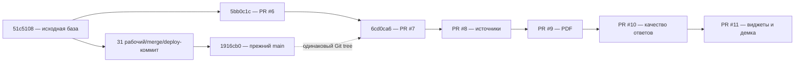
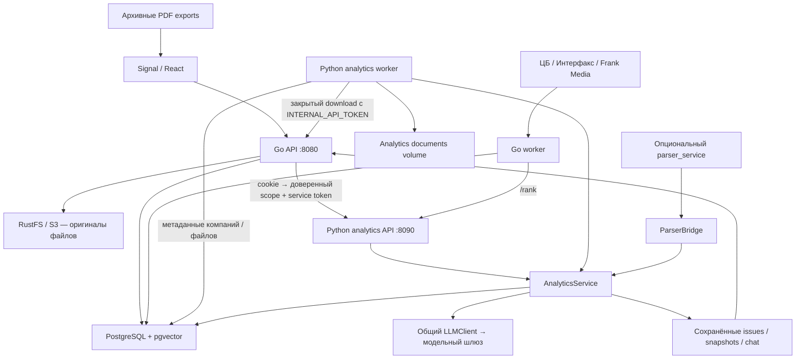
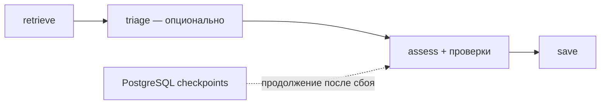
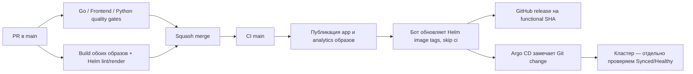

# Альфа-Будущее / Signal — передача проекта агентам коллег

**Дата среза: 25 октября 2026, Europe/Moscow.**

**Репозиторий: [CodeI000I/alpha-hackathon](https://github.com/CodeI000I/alpha-hackathon).**

**Назначение:** самостоятельный технический контекст для продолжения разработки без чтения всего чата.

Документ описывает работу этой сессии: от изолированного аналитического прототипа по
спецификации до объединённого приложения, источников новостей, графиков из PDF,
улучшений качества ответов и интерактивной демки. Он разделяет наш код, интеграцию
изменений коллег, результаты конкретных проверок и незавершённую работу.

## Содержание

1. [Состояние на момент передачи](#state)
2. [Исходная задача и изменения границ](#scope)
3. [Хронология и коммиты](#history)
4. [Пересборка истории main и бэкапы](#git-history)
5. [Карта репозитория](#map)
6. [Архитектура и движение данных](#architecture)
7. [Доменные сущности и инварианты](#domain)
8. [Документы, знания, retrieval и граф](#knowledge)
9. [LangGraph, System One, кеш и очереди](#graph)
10. [Ситуации, сводки и настоящий чат](#situations)
11. [Go API, авторизация и файловый мост](#backend)
12. [Интерфейс и последние изменения демки](#frontend)
13. [Улучшения качества ответов](#quality)
14. [Источники новостей и отдельный парсер](#news)
15. [PDF-графики: происхождение, формат, точность](#charts)
16. [Тестовые профили и повторяемое наполнение](#fixtures)
17. [Аудит надёжности, производительности и зависимостей](#audit)
18. [Конфигурация и команды запуска](#run)
19. [CI/CD, релизы и инфраструктура](#delivery)
20. [Что именно проверено](#validation)
21. [Известные ограничения и незакрытые задачи](#gaps)
22. [План следующей работы и критерии приёмки](#next)
23. [Навигация по документации и правила продолжения](#reading)

<a id="state"></a>
## 1. Состояние на момент передачи

| Объект | Состояние |
|---|---|
| Функциональный коммит | `51397683baf0dfad6e01666c14b837836dc2f520` — PDF-виджеты, ссылки чата, загрузчик профилей |
| Последний main перед добавлением этого отчёта | `1c11501` — автоматическое обновление тегов образов |
| Последний функциональный релиз | `v1.4.0`, указывает на `5139768` |
| Последний функциональный PR | [#11](https://github.com/CodeI000I/alpha-hackathon/pull/11), слит squash в main |
| CI/CD функционального релиза | [Run 40220538467](https://github.com/CodeI000I/alpha-hackathon/actions/runs/40220538467), все 7 jobs успешны |
| Сверка перед подготовкой отчёта | `git fetch origin`; локальный HEAD и origin/main совпали, рабочее дерево было чистым |
| Графики и улучшения аналитики | Уже в main, не только в старых feature-ветках |
| Живая LLM в объединённой демке | **Не проверена: командный ключ в текущем окружении отсутствовал** |
| Работающий кластер | **Argo CD / pod readiness / пользовательский URL вручную не проверялись** |
| Полный локальный Docker/RustFS runtime | **Не запускался: Docker отсутствует на машине проверки** |
| Локальная демка интерфейса | Проверена в браузере; использует настоящие PDF-артефакты и подготовленные новости/ответы |

Более новый коммит самого handoff-документа не означает новую функциональную сборку.
При проверке развёртывания сверяйте не только HEAD main, но и теги образов в Helm:
deploy-коммит по проектной схеме идёт после функционального коммита.

**Корректная формулировка готовности:** объединённый и протестированный прототип
с доступной демонстрацией интерфейса. Полный сценарий с реальными модельными
ответами и целевой инфраструктурой ещё требует репетиции. Зелёный CI не доказывает
смысловую точность LLM, доступность кластера или отсутствие всех возможных ошибок.

<a id="scope"></a>
## 2. Исходная задача и изменения границ

В начале пользователь дал техническую спецификацию аналитического пайплайна.
Её сохранённая версия: [analytics-spec-v1.md](analytics-spec-v1.md).

Первоначальные условия:

- использовать существующую кодовую базу и сначала подтянуть актуальную ветку;
- построить полноценный прототип аналитики;
- **не подключать новый router к действующим backend/frontend**;
- проверять его на временных HTTP-компонентах, БД и модельных transports;
- работать автономно, с разделением задач между более лёгкими агентами;
- каждому агенту, пишущему код, применять Ponytail и Agent Skills;
- искать готовые методы в репозитории и зависимостях перед новой реализацией.

Позже пользователь явно расширил задачу: связать компоненты с приложением,
подтянуть работу коллег, объединить всё в main, проверить CI/CD, затем привести
историю к схеме PR → squash merge. Поэтому раннее ограничение на подключение
router относится к первому этапу, а не к текущему состоянию проекта.

Следующие самостоятельные этапы:

1. Интеграция System One после pull изменений коллег.
2. Полный аудит пайплайна и исправление найденных дефектов.
3. Сборка Signal + Go + analytics в единый runtime.
4. Интеграция нескольких новых frontend-коммитов коллег.
5. Разовая очистка истории main с сохранением файлов и рабочих веток.
6. Уточнение цели: демка с несколькими тестовыми компаниями и новостями.
7. Извлечение графиков из PDF; затем разрешённая пользователем приближённая оцифровка.
8. Улучшение доказательности ответов и диагностики агента.
9. Подключение трёх отобранных RSS.
10. Слияние этих изменений через PR, подключение PDF к dashboard и подготовка ручной демки.

В этой сессии не создавались заново весь frontend, весь backend и System One adapter.
Существующий код и изменения коллег переиспользованы и интегрированы; соответствующее
авторство не следует приписывать этому отчёту.

<a id="history"></a>
## 3. Хронология и коммиты

Числа тестов в таблице относятся к конкретному этапу. Это не несколько разных
оценок одного HEAD и не заявление о повторном выполнении всех исторических проверок.

| Этап | Что сделано | Опорные коммиты / PR | Проверка того этапа |
|---|---|---|---|
| 22–23 октября: исходный прототип | PostgreSQL persistence, знания, события, influence assessment, business issues, snapshots, isolated API/CLI | `ca5c036`, `3c4eea7`, `7898a7e`, `d7bfe31`, `d1d8550`, `59553a3` | Сначала 275 тестов; чтение демо без модельных вызовов |
| Первое опубликование | После отдельного разрешения коммиты и отчёт отправлены в ai-orchestrator | Последний коммит `59553a3` | Удалённый HEAD проверен |
| System One | Подтянут адаптер коллеги, добавлены advisory triage, fallback, кеширование, учёт и восстановление | Adapter `83ee60a` / PR #5; наша интеграция `dd928cd`, `fff8580` | 313 Python-тестов; два PostgreSQL demo режима |
| Аудит | Исправлены гонки, provenance, очереди, context limits, parsing, embeddings, N+1, зависимости | `8131b2c`, `a784db4`, `23b60a1` | 355 Python; Go race/vet; builds; Helm; локальные benchmarks |
| Первое объединение | Signal, Go auth/proxy, analytics API/worker, документы, chat и deploy manifests | `06a1cea` | 372 Python, 121 frontend unit, 38 browser; unified smoke |
| CI cache | Отказ сохранения BuildKit cache перестал блокировать выпуск | `ce48444` | actionlint, 7 проверок условий запуска, review |
| Новые изменения frontend | Три, затем ещё два коммита коллег интегрированы с сохранением auth/analytics | `1a3e291`, `5905bea` | Сначала 148/46, затем 154/55 unit/browser |
| Пересборка main | Тот же итоговый код оформлен двумя squash PR; сохранены новые fixtures коллеги | [#6](https://github.com/CodeI000I/alpha-hackathon/pull/6) → `5bb0c1c`; [#7](https://github.com/CodeI000I/alpha-hackathon/pull/7) → `6cd0ca6` | Деревья до/после идентичны, CI обеих подготовленных версий успешен |
| PDF, первый проход | 97 диаграмм из 9 PDF; 309 подписанных значений | `59dc32d` | 160 unit, 58 browser, 3 Python helper tests |
| PDF, отдельные ряды | Приближённая оцифровка; 253 JSON, 234 SVG; сравнение с оригиналом | `cf89c38`; [#9](https://github.com/CodeI000I/alpha-hackathon/pull/9) → `5a6c26f` | 173 unit, 58 browser, 14 Python helper tests |
| Качество агента | Grounding checks, неполный retrieval, корректный usage, content-free traces, offline eval | `8f9c71b`, `a78252c`, `d26cede`; [#10](https://github.com/CodeI000I/alpha-hackathon/pull/10) → `1309eea` | 404 Python, corpus 16/16 |
| Доверенные источники | ЦБ → Интерфакс/Экономика → Frank Media; host/category/content policy | `bc9e4bc`; [#8](https://github.com/CodeI000I/alpha-hackathon/pull/8) → `fe7575c` | 69 Go-тестов с race, реальные RSS; CI/CD v1.2.0 |
| Последняя демка | Dashboard PDF widgets, versioned citations, локальный seed профилей | `08f85a9`, `8c15bd6`, `2fdf7ba`; [#11](https://github.com/CodeI000I/alpha-hackathon/pull/11) → `5139768` | 174 unit, 66 browser, 20 helpers, unified smoke, actual RSS/API; CI/CD v1.4.0 |

Порядок подготовки веток и порядок слияния PR различались: источники вошли в main
раньше PDF и качества агента. После PR #10 выпущен `v1.3.1`, после PR #11 — `v1.4.0`.
Исторические SHA до очистки main могут отсутствовать в его прямой истории, но
сохраняются в исходных ветках, тегах или локальных бэкапах.

<a id="git-history"></a>
## 4. Пересборка истории main и бэкапы

### Почему понадобилось

Первые интеграции выполнялись обычными merge и прямым push в main. Пользователь
согласовал разовую очистку только main; другие рабочие ветки трогать было нельзя.

Исходная точка до этих интеграций — `51c510837fc6519a49293a3167937f3314776474`.
Пока готовилась пересборка, коллега добавил Miro fixtures. Они также сохранены.

### Как сделано

1. Сохранена полная локальная копия репозитория, Git bundles, refs и контрольные суммы.
2. Создана служебная базовая ветка от `51c5108`.
3. В неё через PR #6 и PR #7 слиты два законченных набора изменений способом squash.
4. На подготовленных версиях выполнен CI.
5. Проверено точное равенство Git tree с актуальным прежним main.
6. Только main одним `force-with-lease` переведён на проверенный результат.
7. Три созданные для операции служебные ветки удалены.

Временный откат опубликованного main на старые manifests не выполнялся: пользователь
сообщил, что Argo CD работает, а его приложение имеет автоматическую синхронизацию
с prune. Без доступа к кластеру показывать ему старый chart было неоправданно.

### Проверка сохранности

| Поле | Значение |
|---|---|
| main непосредственно до переключения | `1916cb051338956301eac8ca824606d5117a1508` |
| main после пересборки | `6cd0ca6c72ee2f094c680f80d30b171029c6be7c` |
| Git tree обеих версий | `88b88580c783d84d979c2de09f041b4cfb6fdc91` |
| Diff файлов и режимов | Пустой |
| Заменённый участок | 31 коммит → 2 squash-коммита |
| Другие refs на тот момент | 4 рабочие ветки и 5 тегов сохранены |



На схеме после PR #7 опущены автоматические deploy-коммиты.

### Где бэкап

На машине автора сессии:

```text
/Users/dvsorochan/Documents/ChatGPT/projects/alpha-hackathon-backups/
  2026-10-24-before-main-history-rebuild-5905bea/
```

Ключевые файлы:

- `repository-full.tar.gz` — исходный checkout с .git и игнорируемыми локальными файлами;
- `repository-before-atomic-promotion.bundle` — refs перед финальным переключением;
- `RESULT.txt` — итог операции и границы проверки;
- `final-verification.json` — точные refs, tree и история;
- `verified-promotion.json`, `SHA256SUMS*` — подтверждение проверок.

Это **бэкап репозитория**, а не PostgreSQL, RustFS или Kubernetes PVC.
Полный архив содержит игнорируемые локальные файлы: не публиковать его как часть
handoff без отдельного просмотра содержимого. Сам handoff секретов не содержит.

Рабочее правило дальше: свежая ветка от актуального main → PR → проверки/review →
squash merge. Не вливать старую локальную историю main обратно обычным merge.
Перед синхронизацией старого клона сохранить незакоммиченные изменения и локальные
коммиты; никакая команда сброса в этом документе автоматически не предписывается.

<a id="map"></a>
## 5. Карта репозитория

| Путь | Назначение / точка входа |
|---|---|
| [README.md](../README.md) | Краткий вход в проект и запуск |
| [frontend/src/App.tsx](../frontend/src/App.tsx) | Маршрутизация интерфейса |
| [frontend/src/api/client.ts](../frontend/src/api/client.ts) | API/demo boundary, транспорт и нормализация ответов |
| [frontend/src/signal/DashboardOverview.tsx](../frontend/src/signal/DashboardOverview.tsx) | Лента, dashboard, раскладка виджетов |
| [frontend/src/signal/ReportWidget.tsx](../frontend/src/signal/ReportWidget.tsx) | PDF widget на главной |
| [frontend/src/pages/IssueDetailPage.tsx](../frontend/src/pages/IssueDetailPage.tsx) | Ситуация, evidence, история и настоящий чат |
| [frontend/src/pages/CompanyPage.tsx](../frontend/src/pages/CompanyPage.tsx) | Профиль, роли, загрузка документов и статусы |
| [backend/cmd/server/main.go](../backend/cmd/server/main.go) | Go HTTP API и статика |
| [backend/cmd/worker/main.go](../backend/cmd/worker/main.go) | RSS и доставка новостей |
| [backend/internal/httpapi](../backend/internal/httpapi) | Сессии, onboarding, файлы, analytics proxy |
| [backend/internal/ingest](../backend/internal/ingest) | Fetch, нормализация, rank/delivery |
| [backend/migrations](../backend/migrations) | Go SQL schema, seed, auth, delivery и источники |
| [orchestrator/llm.py](../orchestrator/llm.py) | Общий structured LLM client, кеш/лимиты/usage |
| [orchestrator/decision.py](../orchestrator/decision.py) | System One и LLM fallback |
| [orchestrator/analytics/app.py](../orchestrator/analytics/app.py) | Текущий Python API host |
| [orchestrator/analytics/service.py](../orchestrator/analytics/service.py) | Бизнес-операции, LangGraph, jobs и chat |
| [orchestrator/analytics/knowledge.py](../orchestrator/analytics/knowledge.py) | Parsing, факты, retrieval, graph paths |
| [orchestrator/analytics/synthesis.py](../orchestrator/analytics/synthesis.py) | Группировка impacts и синтез issues/snapshots |
| [orchestrator/analytics/store.py](../orchestrator/analytics/store.py) | PostgreSQL/MemoryStore, scope/version/locks |
| [orchestrator/analytics/integration.py](../orchestrator/analytics/integration.py) | Контракты Go → analytics, текущий /rank |
| [orchestrator/analytics/worker.py](../orchestrator/analytics/worker.py) | Синхронизация backend, файлов и обработка jobs |
| [orchestrator/analytics/parser_bridge.py](../orchestrator/analytics/parser_bridge.py) | Отдельный вход данных parser_service |
| [parser_service](../parser_service) | Ограниченный parser/crawler и его jobs |
| [fixtures/miro-personas](../fixtures/miro-personas) | Синтетические компании, документы и новости |
| [eda/report_charts](../eda/report_charts) | Ручная проверяемая разметка PDF |
| [frontend/public/report-charts](../frontend/public/report-charts) | Публикуемые каталоги, картинки, CSV/JSON/SVG |
| [scripts/test_unified.py](../scripts/test_unified.py) | Сквозной временный Go/Python/PostgreSQL/S3 smoke |
| [scripts/seed_demo_profiles.py](../scripts/seed_demo_profiles.py) | Загрузчик тестовых профилей через настоящий API |
| [deploy](../deploy) | Helm, Argo CD и шаблоны секретов |

<a id="architecture"></a>
## 6. Архитектура и движение данных

### Сервисы



Важные различия:

- Go worker доставляет новости в привычную ленту через `/rank`.
- Python worker синхронизирует профиль/документы, выполняет extraction и analytics jobs.
- Parser service — отдельный вход, выключенный по умолчанию; его нельзя считать
  автоматическим скачивателем всех полных статей из трёх RSS.
- Статические PDF-виджеты подключены к frontend. Они не поступают автоматически
  в company knowledge, retrieval или контекст LLM.
- Старый `orchestrator.api` и legacy SQLite pipeline сохранены для совместимости,
  но Compose/Helm запускают `orchestrator.analytics.app:create_app`.
  Не запускать старый host вместо нового, ориентируясь только на ранний README.

### Путь новости

1. Go читает включённые источники и проверяет полученные элементы.
2. Новость сохраняется с идентичностью источника, ревизией и активностью.
3. Транзакционная delivery queue связывает ревизию новости с пользователем.
4. Go передаёт новость, компанию и роли в Python `/rank`.
5. `integration.rank` синхронизирует company profile и создаёт `NewsArticle`.
6. Analytics извлекает общее событие и оценивает влияние на конкретную компанию.
7. Подбираются evidence; выполняются assessment и проверки оснований.
8. Для accepted influence строится совместимый feed result; для ролей обновляется snapshot.
9. Go публикует rows ленты атомарно; старые результаты исправленной новости скрываются.

`score` в совместимой ленте — **ordinal urgency**, а не вероятность:
none=0, unknown=0.25, monitor=0.5, soon=0.8, immediate=1.
Mixed risk/opportunity отображается legacy-kind `event`. Не интерпретировать 0.8 как
«80% вероятности», не суммировать такие числа и не использовать их для финансового расчёта.

### Путь документа

1. Пользователь загружает файл через авторизованный Go API.
2. Оригинал сохраняется в RustFS, метаданные — в PostgreSQL.
3. Python worker обнаруживает файл, получает его через закрытый file bridge.
4. Проверяется company scope, размер и содержимое, сохраняется локальная analytics-копия.
5. Parsing/OCR → chunks → extraction facts/edges → атомарная публикация ревизии.
6. Изменение знаний ставит reprocess job; worker проходит общий архив событий
   для этой компании, переиспользуя совпавшие fingerprints/cache. Узкий отбор
   только затронутых зависимостей из спецификации пока не реализован.
7. UI получает статусы анализа отдельно от статуса HTTP-загрузки.

### Путь чтения

Готовые ситуации, evidence, история и сводка читаются из сохранённых данных.
Обычный GET не должен обращаться к LLM. Новый вопрос, refresh/reprocess или новое
содержание могут создавать модельную работу, что отражается в ledger/jobs.

<a id="domain"></a>
## 7. Доменные сущности и инварианты

Контракты: [analytics/models.py](../orchestrator/analytics/models.py).

| Сущность | Что представляет | Критическое правило |
|---|---|---|
| `Scope` | tenant/company, при необходимости user/role | Чужой scope нельзя получить из браузерного параметра без проверки |
| `NewsArticle` | Конкретная ревизия источника | source + news_id + revision и provenance должны сохраниться |
| `Event` | Нормализованное внешнее событие | Publication time не подменяет event time; correction/cancel учитываются |
| `SourceDocument / SourceChunk` | Версия документа и цитируемые части | Digest, offsets, текст и locator проверяются до записи |
| `CompanyFact` | Факт, утверждение, план либо иной элемент знаний | Verification/validity не теряются при retrieval |
| `CompanyProfile` | Профиль и факты компании | Ручной профиль помечается user_asserted |
| `KnowledgeEdge / CandidatePath` | Подтверждённые связи и ограниченные пути | Наличие связи требует источника; циклы не становятся доказательствами |
| `EvidencePack` | Фактически выбранный контекст | Полнота и статус context_truncated влияют на допустимость вывода |
| `ImpactAssessment / CompanyImpact` | Влияние события на компанию | Проверяемая causal chain; unknown не превращается в no |
| `BusinessIssue` | Объединённая бизнес-ситуация | Сохраняет версии evidence и может быть mixed |
| `SituationSnapshot` | Сохранённый обзор на момент времени | Freshness учитывает версии и временную применимость |
| Conversation / user state | Диалог и персональные отметки | Scope пользователя, версия ситуации, идемпотентность request_id |
| Job / run / checkpoint | Операционное состояние обработки | Не заменяет бизнес-историю; bounded retry и восстановление |

Основное хранилище аналитики — PostgreSQL с версионными JSONB records, отдельными
индексами поиска и pgvector. Для тестов существует MemoryStore. Применяются
optimistic concurrency и advisory locks. Это не отдельная ORM на каждую сущность.

### Физическое хранение и границы модели

`analytics.records` хранит append-only JSONB-версии с ключом
`(kind, tenant_id, company_id, record_key, version)`. `analytics.record_heads`
указывает на текущую версию через внешний ключ. Отдельно существуют таблицы cache,
budgets и calls; поиск вынесен в `analytics.search_documents`, конфигурация векторов —
в `analytics.embedding_models`. Версия записи Store и доменная ревизия объекта —
разные понятия, их нельзя автоматически приравнивать.

Только article/event/entity могут быть общими, с пустыми tenant/company.
Остальные виды записей требуют company scope. В runtime используется PostgresStore;
MemoryStore — реализация для тестов. Миграции доменной схемы и `PostgresSaver.setup()`
проходят под общим межпроцессным advisory lock.

Часть названий исходной спецификации представлена обычными payloads или общими
records, а не отдельными Pydantic-классами: Entity, BusinessFactor,
BusinessIssueVersion, AnalysisRun, Conversation и Message. Claim/Answer и digest
переиспользованы из общих моделей. Business factor ограничен десятью разрешёнными
значениями. `Impact.event_probability` сейчас всегда `None`: численной оценки
вероятности события система не предоставляет.

У Event разделены время публикации и время события, а также modality:
realized / announcement / plan / forecast / proposal / unknown. Предположение
о бизнес-факторе не становится подтверждённым фактом только из-за извлечения моделью.

Нельзя смешивать:

- граф знаний компании и граф исполнения LangGraph;
- доверие к источнику и релевантность конкретной новости;
- существование citation ID и истинность интерпретации LLM;
- сохранённый snapshot и актуальный пересчёт;
- наличие файла в S3 и успешное использование его в анализе.

<a id="knowledge"></a>
## 8. Документы, знания, retrieval и граф

### Извлечение

Поддерживается аналитический parsing TXT/MD/HTML/PDF/DOCX, включая OCR PDF.
У frontend сейчас есть отдельное несоответствие с XLSX — см. незакрытые задачи.

Сохраняются оригиналы, digest исходных байтов, digest текста, chunks и locators.
Перед записью проверяются offsets, namespace, уникальность chunk IDs и соответствие
выделенного текста оригинальному parsed document. Результаты extraction и готовая
ревизия документа публикуются атомарно.

Русский и английский OCR подготовлены локально в предыдущих тестах. Наличие
проверенного OCR fixture не означает, что любой скан будет распознан качественно.
Ограничены размеры, страницы/геометрия и объём извлекаемого текста; текст проверяется
во время накопления, а не после потенциально огромной склейки.

Текущие защитные пределы: оригинал 12 MiB, распакованный DOCX 48 MiB,
извлечённый текст 1 млн символов, PDF 500 страниц, chunk 4000 символов,
не более 500 chunks. OCR: 300 dpi, 25 мегапикселей на страницу и 200 мегапикселей
на документ. Эти ограничения — верхние границы входа, не обещание одинаковой
скорости обработки всех допустимых документов.

Факт из заполненного пользователем профиля считается `user_asserted`, а не
независимо подтверждённым договором. Даты и проверенная цитата помогают сохранить
происхождение, но не доказывают правильное распознавание отрицаний или условий договора.

### Retrieval

Реализация объединяет:

- точные subject/object IDs и совпадения сущностей;
- lexical BM25 и PostgreSQL FTS;
- опциональные локальные semantic embeddings;
- ограниченные типизированные пути графа;
- фильтры tenant/company, ревизии и временной применимости.

По умолчанию `EMBEDDING_BACKEND=lexical`. Это рабочая базовая конфигурация.
Для local embeddings нужна заранее подготовленная pinned модель; автоматический
платный embeddings endpoint шлюза не придумывался.

Настройки по умолчанию: `ANALYTICS_TOP_K=12`, graph_depth=2, graph_enabled=true.
При неполном наборе кандидатов нельзя выдавать уверенное «никакого влияния нет».
Сбой semantic поиска явно отмечается fallback; он не должен выглядеть как
успешный семантический retrieval.

Результаты каналов объединяются Reciprocal Rank Fusion с весом `1 / (60 + rank)`.
Есть режим `all` по умолчанию и более избирательный `indexed`, с причинами отбора
и fallback в диагностике. FTS использует русскую конфигурацию и GIN; pgvector
выполняет точное cosine-сравнение `<=>`, ANN-индекс в этой версии не создан.
Размерность, model version и text version проверяются перед использованием вектора.

Граф ограничен current/ready chunks одной компании, валидными подтверждёнными
edges и небольшой глубиной. Обход допускает обе стороны adjacency, сохраняя
направление исходной связи; циклы и слишком общие узлы не добавляют доказательств.
Нормализация IDs использует NFC, регистр и пробелы; полноценного entity resolution
или общего справочника алиасов в HybridRetriever нет. Aliases профиля помогают
предварительному выбору кандидатов в другом слое.

Поле `EvidencePack.related_events` существует в модели, но текущий retrieval его
не заполняет. Полный материализованный GlobalEventGraph из исходной спецификации
не построен: есть общие event records/index и частный граф документных знаний.
BM25 и работа с историческими records сохраняют линейные участки; эту архитектуру
пока нельзя считать проверенной на многомиллионном корпусе.

### Embeddings и Graphify

Используется `sentence-transformers/paraphrase-multilingual-MiniLM-L12-v2` с
закреплённой ревизией. Исправлено молчаливое усечение длинных chunks:
token windows → взвешенная агрегация → нормализация.
Совместимость версии/размерности vectors проверяется; старые и новые индексы
не следует смешивать.

Размерность MiniLM — 384; версия оконного преобразования содержит
`token-windows-v1`. При смене алгоритма нужна явная переиндексация, а не только
замена имени модели в настройке.

`KnowledgeService.reindex(scope)` переиндексирует текущие знания атомарно без
новой ревизии документа и без повторного LLM extraction. Если нужны новые оценки,
reprocess выполняется явно и отдельно.

Graphify выключен. Реализован импорт подготовленного нормализованного JSON для
конкретной ревизии документа с проверкой ссылок, цитат и дат. Внешний Graphify
extractor не запускался и не является необходимой частью базового runtime.

### Ревизии новостей и идентичность событий

Из одного article текущий extractor получает одно основное событие. Повтор ключа
article/revision с другим содержимым считается конфликтом; поздно пришедшая
старая ревизия не должна откатывать актуальные evidence. Точное совпадение
нормализованных title/content дедуплицируется в пределах дня публикации.

Идентичность нормализованного события учитывает type/action/subject/entities,
event_time, project и conditions. При неизвестном event_time сохраняется привязка
к article key, чтобы не склеить произвольные события. Реализованы correction,
supersede, cancel и повторная активация. Это ограниченная событийная нормализация,
а не универсальное разрешение всех упоминаний одной сущности во всех источниках.

<a id="graph"></a>
## 9. LangGraph, System One, кеш и очереди

### Реальный граф



LangGraph используется в цепочке оценки влияния.
Ingestion, synthesis, snapshots и chat — идемпотентные service operations и jobs;
они не превращены искусственно в отдельные большие графы.

PostgresSaver сохраняет точку продолжения. Успешные дорогие шаги кешируются:
после сбоя assess готовый triage не должен вызываться повторно.
В тесте восстановления заново открывались Store/Saver и создавался service,
то есть проверялся не только повтор в том же Python-объекте.

Полный путь графа: START → retrieve → triage → assess → save → END.
При найденном пригодном cache результат возвращается после retrieve. Узел triage
остаётся в топологии и при выключенном triage, но не выполняет модельный вызов.

### Почему в старом коде можно увидеть пять графов

Legacy `orchestrator/graphs.py` и `pipeline.py` сохраняют прежние отдельные
topologies: event ingestion, company scoring, открытие отчёта, report generation
и conversation. В report/conversation есть bounded search/revise/verify ветвления.
Generic nodes требуют соответствующих handlers; без них возможен
`NotImplementedError`. `Pipeline.search_external` в legacy варианте возвращает
`access_error`, а не реализует универсальный web search.

Поэтому наличие пяти описаний графа в репозитории не означает, что каждый из них
подключён к нынешнему приложению. Старые пороги scoring 0.35/0.7 и SQLite defaults
также нельзя переносить в текущую analytics policy без отдельного решения.

### System One

- Adapter первоначально пришёл из ветки коллеги, затем был интегрирован.
- Включение: `ANALYTICS_TRIAGE_ENABLED=true`; default false.
- Один `AI_SYSTEMONE_URL` не включает triage автоматически.
- При недоступности/лимите/некорректном ответе используется предусмотренный LLM fallback.
- Triage advisory: `irrelevant` не скрывает новость, priority не подменяет urgency.
- Сохраняются фактический provider, policy/context version, latency и usage.
- Ограничены response bytes, ожидание lock, timeout/cooldown; редиректы не принимаются
  как произвольное разрешение передать запрос другому сервису.

### Инвалидация и бюджет

Ключи результатов учитывают модель, policy, prompt/config, источники, знания и
реальный evidence fingerprint. Смена политики grounding или retrieval делает
старую оценку устаревшей, сохраняя историю.

Общий LLMClient ограничивает input/output, concurrency, RPM, retries и учитывает
usage/latency. Исчерпание бюджета имеет явный статус и сохраняется между запусками.
Transport retry ограничен; отдельный неограниченный self-repair loop не добавлен.

Concurrency ограничивается semaphore на экземпляр LLMClient. RPM резервируется
в общем ledger по hash API key в используемой БД: API и worker с одной БД делят
этот лимит. Блокировка бюджета сохраняется до 03:00 МСК. Ledger хранит вызовы и
токены; полноценного расчёта стоимости в рублях по тарифам провайдера нет.

Retention по умолчанию 30 дней очищает операционные cache/calls/budget blocks и
checkpoints завершённых impact runs. Бизнес-история не удаляется. Это не политика
удаления аккаунта или персональных данных; такую процедуру нужно проектировать отдельно.

Полный assessment context не режется молча ради успешного ответа. Если инструкция,
схема и evidence не помещаются, получается `needs_context/context_limit`.
Необязательный triage не должен вытеснять основные доказательства.

### Две очереди

| Очередь | Работа | Существенные гарантии |
|---|---|---|
| Go `news_deliveries` | Доставка news revision пользователю и публикация feed | Claim, lease, fencing, backoff, атомарная замена результата |
| Python analytics jobs | Пересчёт impact → issues → snapshot по сохранённым знаниям | Debounce, limited retries, budget pause, locks, checkpoint recovery |

Извлечение документов worker выполняет отдельно в `_sync_file`, сохраняя состояние
`integration_file`. `ingest_company_document` синхронно выполняет knowledge ingestion
и затем ставит reprocess job. Отдельного extraction handler внутри очереди analytics
jobs нет. Job lease составляет час; временные отказы откладываются минимум на
60 секунд. Budget pause, отсутствие конфигурации и lock contention не расходуют
попытку так же, как ошибка выполнения задания.

Историческая Go policy включает failed после 8 ошибок, backoff до 300 секунд;
фактическое время повторов зависит и от worker cadence. Не переносить эти значения
на Python jobs: analytics default attempts=3, debounce=30s.

Не считать lock contention модельной ошибкой: StoreBusy преобразуется в явный
503/отложенную работу. Retry failed jobs выполняется осознанно после устранения причины.

<a id="situations"></a>
## 10. Ситуации, сводки и настоящий чат

CompanyImpact группируются по подтверждённой бизнес-связи, фактору и горизонту.
Несколько новостей могут поддерживать одну BusinessIssue.
Риск и возможность сохраняются как mixed, а не вычитаются арифметически.
Денежные эффекты и вероятности не суммируются без отдельной обоснованной модели.

Группировка детерминирована supported exposure + factor + horizon. Если подтверждённой
общей exposure нет, отдельные impacts сохраняют собственную идентичность: одного
совпадения фактора для склейки недостаточно. Один accepted impact преобразуется
в issue детерминированно, несколько требуют проверяемого LLM synthesis.
Пустой snapshot и snapshot из одной issue также не нуждаются в модели; для
нескольких issues выполняется synthesis. Поддержанные risk/opportunity сохраняют
mixed даже при попытке модели сгладить одну из сторон.

Без фактов, при неактивном событии или переполненном контексте assessment может
завершиться детерминированным статусом без LLM. Это осознанное сокращение ненужных
вызовов. Полный семантический split/merge/change-classification business issues
из расширенной спецификации пока не реализован.

Snapshot содержит готовый обзор, priorities, изменения и версии issues.
Новые знания или срок применимости делают прежний результат `current=false` до
пересчёта. При неизменном содержании можно переиспользовать текст synthesis,
обновив метаданные без лишнего вызова модели.

### Chat contract

Настоящий чат доступен **внутри бизнес-ситуации**, а не как общий свободный chatbot.

`POST /v1/analytics/issues/{issue_id}/questions` принимает:

- question длиной 1–6000 символов;
- conversation_id;
- request_id;
- опциональную явную version ситуации.

Диалог закреплён за версией issue и user scope. Повтор request_id идемпотентен.
В модель передаётся ограниченный контекст истории — последние шесть ответов.
Hypothetical question не изменяет факты компании.
Чтение conversation/history не должно вызывать LLM.

После обновления issue старый разговор остаётся доступным; новый диалог предлагается
начать отдельно. Нельзя привязать старую реплику к evidence новой версии автоматически.

### Исправление ссылок в последнем PR

В `IssueDetailPage` известные evidence IDs стали ссылками на соответствующие
отрисованные факты, chunks, пути и новости; нужный details раскрывается.
Повторные, неизвестные и неоднозначные ID остаются текстом.

Независимое review нашло гонку: issue мог уже обновиться, а evidence ещё относился
к прежней версии. Исправлено:

1. Evidence query запускается после получения version issue.
2. Version входит в React Query key.
3. Version передаётся в HTTP query.
4. При переключении версии старые evidence не используются для новых ссылок.
5. Закреплённый старый разговор не получает ложные ссылки на новые основания.

`api.analytics.evidence(issueId, role, signalInput?, version?)` сохраняет старую
позицию аргумента отмены запроса. Сервер уже поддерживал version, новый API для
этого не изобретался.

<a id="backend"></a>
## 11. Go API, авторизация и файловый мост

Контракт: [backend/API.md](../backend/API.md).
Go endpoints доступны под `/api/v1`.

### Идентичность

- Регистрация компании и первого пользователя — транзакционный `POST /onboarding`.
- Идемпотентность использует request key и hash; частичная регистрация не оставляет
  компанию без пользователя.
- Login/me/logout используют cookie `alpha_session`.
- Пароль хранится bcrypt-хешем, случайный session token — SHA-256 хешем в БД.
- HttpOnly, SameSite=Strict, срок сессии семь дней; Secure включён по production default.
- Локальная конфигурация явно задаёт `SESSION_COOKIE_SECURE=false` для HTTP loopback.
- Мутации проходят проверку same origin.

Старым аккаунтам пароль автоматически не назначался. Есть операторская
команда `backend/cmd/set-password`; безопасный способ ввода описан в API.md.
Не вставлять рабочие пароли в shell history или отчёт.

### Tenant/company boundary

Production Go server включает RequireAuth. Company/user и допустимая роль
проверяются по сессии. Backend сам формирует доверенные заголовки для Python:
tenant `alpha`, company, user, role.
Заголовки scope, произвольно присланные браузером, не являются авторизацией.

Python boundary проверяет bearer `AI_SERVICE_TOKEN`.
`INTERNAL_API_TOKEN` отдельно защищает скачивание оригинала файла Python worker.
Ни один из этих токенов не должен попасть во frontend build, localStorage или URL.

### Analytics proxy

Go проксирует ограниченный список операций: situation/documents/issues,
evidence/history/state, conversations/questions, refresh/jobs.
Роль передаётся клиентом в query, проверяется сервером и превращается в доверенный
scope. Произвольный Python URL через этот proxy недоступен.
Global news ingestion и company mutation не открыты как произвольные браузерные маршруты.

| Операция Python | Назначение |
|---|---|
| GET `/v1/analytics/situation` | Готовая сводка |
| GET `/v1/analytics/issues` | Список, offset/limit |
| GET `/v1/analytics/issues/{id}` | Конкретная версия ситуации |
| GET `/v1/analytics/issues/{id}/evidence` | Основания, опционально version |
| GET `/v1/analytics/issues/{id}/history` | История |
| GET/PATCH `/v1/analytics/issues/{id}/state` | Прочитанность, pinned, workflow |
| POST `/v1/analytics/issues/{id}/questions` | Вопрос к ситуации |
| GET `/v1/analytics/conversations/{id}` | Сохранённый разговор |
| POST `/v1/analytics/refresh` | Постановка пересчёта |
| GET `/v1/analytics/jobs/{id}` | Статус задания |

Это карта Python API, не предложение обращаться к нему прямо из браузера,
минуя Go auth. Фактический frontend prefix — `/api/v1/analytics`.

### Хранение и readiness

Файл через Go ограничен 12 МиБ. RustFS хранит оригиналы, PostgreSQL — метаданные,
analytics volume — копии для обработки. Восстановление только PostgreSQL не
восстановит утраченные оригиналы.

Go и Python имеют отдельные `/healthz` и `/readyz`. Liveness подтверждает процесс;
Go readiness проверяет PostgreSQL, Python — analytics store и настроенный backend
repository. Readiness не подтверждает S3, внешнюю LLM, наличие бюджета и качество ответа.

<a id="frontend"></a>
## 12. Интерфейс и последние изменения демки

В ходе объединения сохранены новые Signal-компоненты коллег и существующие
auth/analytics integration. Добавлены и проверены явные loading/error/retry,
безопасные IDs/URLs, onboarding replay, пустая лента, role/type filters,
сводка за 24 часа, polling и обработка keyboard/accessibility сценариев.

### Три разных режима проверки

| Режим | Данные | Что подтверждает |
|---|---|---|
| `VITE_DATA_MODE=demo` | Подготовленная лента, пользователи и ответы; реальные статические PDF exports | UX, отображение, локальное сохранение настроек |
| Browser tests с controlled API | Подставные HTTP-ответы, ошибки, гонки | Поведение UI и API client |
| Полный API runtime | Go + PostgreSQL + S3 + analytics + LLM | Реальную обработку, если действительно запущен и проверен |

Нельзя выдавать первый или второй режим за проверку модели.

### PDF widget

- Добавлена категория «Отчёты» и «График из PDF».
- Можно выбрать document → chart → отдельный series.
- Новым аккаунтам по умолчанию показывается `fi-monetary-policy--key-rate`.
- Существующие сохранённые layouts не перезаписываются.
- Сохраняются добавление/удаление, порядок и выбор ряда в scope пользователя/компании.
- Переиспользованы validators catalog/index/series и уже экспортированный SVG.
- Есть loading/error/retry, пустые данные, unavailable и ошибка SVG.
- Видны архивность, исходный PDF/страница, approximate/labelled status и прогнозность.
- Есть ссылки на оригинальный crop, JSON ряда и полный каталог.
- Это отображение SVG: нового интерактивного движка с hover по точкам не добавляли.

Старые синтетические рыночные widgets остаются примерами с соответствующими
пояснениями. Не подключены автоматически текущие котировки или live chart API.

### Подготовленный чат на dashboard

DemoChat не отправляет вопрос серверу и не читает корпоративные документы.
Он сохраняет до 50 пар сообщений в localStorage текущего пользователя/компании.
Его назначение — попробовать интерфейс. Настоящий chat находится на странице issue.

### Изменённые файлы PR #11

- `frontend/src/signal/ReportWidget.tsx`;
- `frontend/src/signal/DashboardOverview.tsx`;
- `frontend/src/signal/styles/overview.css`;
- `frontend/src/pages/IssueDetailPage.tsx`;
- `frontend/src/api/client.ts`;
- unit/e2e tests;
- `scripts/seed_demo_profiles.py` и его tests;
- Makefile, README, docs/demo-profiles.md, docs/report-charts.md;
- Python helper step существующего CI.

Новых runtime-зависимостей ради этих изменений не добавлялось.

<a id="quality"></a>
## 13. Улучшения качества ответов

Подробный отчёт: [agent-answer-quality.md](agent-answer-quality.md).

Пользователь предложил tracing, reflection, planning, memory, structured output,
tool error handling и разделение моделей. Сначала проверено, что уже существует:
Pydantic-контракты, LLMClient, retries, checkpoint persistence, versioned conversation
и модельные overrides. Дублирующий JSON parser или ещё одна система памяти не добавлены.

### Что изменилось

| Раньше могло пройти | Теперь |
|---|---|
| Chat без источников и без признания пробела | Требуются допустимые evidence_ids или непустые missing_facts |
| Influence без объяснения связи с компанией | Causal chain должна ссылаться на новость и основание компании |
| Ссылка на path обходила статус исходного факта | Проверяется и факт связанного chunk: conflict/verification/validity |
| Неполный retrieval давал уверенное «не влияет» | Negative/neutral result при context_truncated требует контекст |
| Уже включённый через факт/path chunk считался потерянным | Полнота считается по всем включённым chunks |
| JSON отмечался успешным до validation | calls.status=ok записывается после проверки |
| Прерывание validator теряло полученные токены | cancelled сохраняет usage и распространяет исходное прерывание |

Ошибка grounding не создаёт дополнительный платный retry. Policy digest изменён,
поэтому прежние impacts не считаются свежими; история не удаляется.

### Tracing

Стандартный JSON logger `orchestrator.quality` пишет:

- `graph_node`: run_id, policy, node/span, duration, outcome/error code;
- `llm_structured`: stage, model, schema, cache hit, validation outcome и duration;
- run diagnostics: route, количество evidence/claims, context_truncated, ошибочный узел/фазу.

В лог не попадают полный prompt, документ, ответ, API key или необработанный exception.
Cache hit виден в tracing и не увеличивает счётчик платных calls.

Langfuse/LangSmith не подключены к внешнему хранилищу.
Универсального planner, дополнительного LLM-критика, self-correction loop и HITL
для внешних действий пока нет. Текущий аналитический агент не отправляет письма,
не исполняет пользовательский SQL и не управляет внешними системами.

### Offline quality corpus

`orchestrator/analytics/evals/answer-quality.json` содержит 16 сценариев:
fixed/floating contract, missing evidence, cancellation/expiry, conflicting facts,
empty grounding, foreign citation, invalid schema, incomplete retrieval, mixed
impact и варианты ответа чата.

Используются настоящие retriever, StateGraph, LLMClient и validators;
HTTP подставляется SyntheticGateway/MockTransport.

- Прежние правила `6cd0ca6` нарушали ожидания в 5 из 16 сценариев.
- Новые проходят 16 из 16.
- Оба сравнения использовали 48 синтетических HTTP-вызовов.
- Это измерение правил публикации, **не точности реальной LLM**.

<a id="news"></a>
## 14. Источники новостей и отдельный парсер

Актуальная конфигурация задаётся
[0007_curated_news_sources.sql](../backend/migrations/0007_curated_news_sources.sql).
Детали выбора: [news-sources.md](news-sources.md).

| Порядок | Source ID / класс | URL | Что используем |
|---|---|---|---|
| 1 | S077, official_primary | https://www.cbr.ru/rss/RssPress | Пресс-релизы ЦБ; metadata_only |
| 2 | S136, established_media | https://www.interfax.ru/rss | Только категория «Экономика»; metadata_only |
| 3 | S142, industry_media | https://frankmedia.ru/feed | Банки/финансы; текст, уже находящийся внутри feed |

Priority задаёт порядок опроса; это не численная вероятность истинности
и не гарантия корректности любой публикации. Первичный официальный источник
предпочтительнее вторичного сообщения, но каждой новости всё равно нужны provenance
и корректная обработка неполноты.

### Почему не все пункты Miro

Проверялся ограниченный набор более официальных и профильных кандидатов.
Росфинмониторинг не включён из-за проблемы проверки TLS при тогдашнем доступе;
БКС блокировал доступ. Также встречались недоступные/пустые feeds, timeout и
заголовки без полезного текста. Защиты и TLS не отключались ради подключения.

Это результаты конкретной проверки, не вечный запрет на эти источники.
Для добавления кандидата нужно заново проверить контракт, доступность,
качество данных, category/host policy и написать fixture тест.

### Поведение Go RSS

- Источники берутся из sources.config, порядок сохранён.
- По умолчанию запуск при старте worker и далее раз в 15 минут.
- Фильтр категории Интерфакса применяется до обработки элементов.
- Ограничен размер ответа 8 МиБ; у рабочего HTTP-клиента 30-секундный timeout.
- Для curated sources проверяются HTTPS, разрешённые article hosts и same-origin redirects.
- Для ЦБ/Интерфакса body пустой: нельзя выдавать описание RSS за полный текст статьи.
- Frank Media предоставляет feed_content: сохраняется то, что есть в RSS.
- **Go worker не скачивает web-страницы всех этих публикаций.**
- Прежний широкий seed-набор отключён для будущего сбора, исторические новости
  и пользовательские источники миграция не удаляет.

Последний реальный сбор во временную БД: 14 ЦБ + 1 Интерфакс + 60 Frank Media = 75.
Число записей зависит от времени и фильтров; это не тест на постоянный размер ленты.
Старые числа raw feed items в docs/news-sources.md относятся к другому прогону.

### Отдельный parser_service

Это ограниченный путь CBR RSS → разрешённые HTML /press/ → normalized material.
Есть PostgreSQL jobs, policy, лимиты bytes/time/frequency и provenance.
Он не превращает Go feed_content в полный web crawler и не импортирует автоматически
результат обратно в Go news feed.

По умолчанию `PARSER_CBR_ALLOW_FETCH=false` и `PARSER_CBR_ALLOW_PERSIST=false`.
Нужны явное включение, parser DSN и согласованная policy version.
Ограничены host/robots/redirects; скачивание произвольных PDF не включено.
AlfaFetcher без согласованного контракта явно сообщает ошибку, а не успешную пустую ленту.

<a id="charts"></a>
## 15. PDF-графики: происхождение, формат, точность

Исходные отчёты пользователь указал в локальных Downloads — папкой и архивом.
В репозиторий добавлены проверяемые производные материалы и provenance.
Для воспроизведения извлечения с нуля потребуется получить исходные PDF отдельно;
существующие exports можно проверять без них.

### Два этапа

1. Из 9 PDF выделены 97 диаграмм и исходные crops. Перенесены 309 явно подписанных
   значений, охватывавших 31 диаграмму. Остальные 66 первоначально оставались изображениями.
2. Пользователь отдельно разрешил **приближённую оцифровку линий**.
   Каждый ряд на общей плоскости стал отдельным файлом.
   Неразличимые данные получили unavailable с объяснением.

| Артефакт | Количество в текущем наборе |
|---|---:|
| Исходные PDF в метаданных каталога | 9 |
| Диаграммы и JPEG crops | 97 |
| Отдельные series JSON | 253 |
| Приближённые digitized ряды | 194 |
| Ряды labelled_values | 40 |
| Unavailable JSON с причиной | 19 |
| SVG для доступных рядов | 234 |
| Приближённые опорные точки | 7 050 |
| Сохранённые напечатанные значения | 309 |

Ряды и диаграммы — разные единицы: если на одной диаграмме несколько линий,
из неё экспортируется несколько series. Часть точных подписей хранится внутри
digitized рядов; поэтому число labelled_values файлов не равно числу диаграмм
с любыми напечатанными значениями.

### Исходные документы

- `FI_Strategy_3Q26_22072026.pdf` — 27 страниц.
- `ALFA-7M26.pdf` — 4.
- `ALFA-Macro_Insights-Policy_Rate_11Sep.pdf` — 4.
- `ALFA-consumption.pdf` — 4.
- `ALFA-macro_stat1H26.pdf` — 5.
- `Gold_digest_August26.pdf` — 8.
- `Inflation_tracker_02.pdf` — 3.
- `Бонд_Бриф_14092026.pdf` — 5.
- `ALFA_Russian_Steels_1К21PreviewUpdate_15Apr2021.pdf` — 4.

### Где и в каком виде

| Файл / каталог | Содержимое |
|---|---|
| `frontend/public/report-charts/catalog.json` | schema_version, documents, charts |
| `frontend/public/report-charts/series-index.json` | schema_version и индекс отдельных series |
| `frontend/public/report-charts/series/*.json` | Один ряд, source, шкалы, points/exact_points, status/limitations |
| `frontend/public/report-charts/series/*.svg` | Отдельная визуализация доступного ряда |
| `frontend/public/report-charts/images/*.jpg` | Фрагменты оригинальных страниц |
| `frontend/public/report-charts/points.csv` | Напечатанные значения |
| `eda/report_charts` | Источник разметки/калибровки |
| `scripts/prepare_report_charts.py` | Экспорт и проверка согласованности |
| `scripts/report_chart_series.py` | Формирование отдельных рядов и SVG |

Сокращённый реальный пример полей из `fi-floater-index--ruflbicp.json`
(это выдержка, не полная схема):

```json
{
  "schema_version": 1,
  "id": "fi-floater-index--ruflbicp",
  "chart_id": "fi-floater-index",
  "series_id": "ruflbicp",
  "label": "RUFLBICP",
  "unit": "пункты индекса",
  "data_status": "digitized",
  "points": [
    {"x": 0.0, "value": 96.22},
    {"x": 0.0086, "value": 95.75}
  ],
  "json_file": "series/fi-floater-index--ruflbicp.json",
  "svg_file": "series/fi-floater-index--ruflbicp.svg"
}
```

Полная запись дополнительно содержит document filename/SHA-256, page, crop,
image/SHA-256, x_axis, x_ticks, plot bounds, anchors, estimated_error и примечания.

### Что означают числа

- x у digitized points — нормированная позиция 0…1, не готовая дата и не номер биржевого дня.
- Подписи временной оси сохранены отдельно в ticks.
- Между опорными точками линий — линейная интерполяция, не восстановленные исходные наблюдения.
- Напечатанные числа сохранены отдельно и не заменены визуальной оценкой.
- Диапазоны и отрицательные части stacked charts имеют отдельное представление.
- Прогноз/факт не объединяются молча.
- estimated_error — визуальная оценка, не доверительный интервал и не гарантия.
- Погрешность X не оценена; обрезанные пики и пропуски не «додуманы».
- Unavailable не должен превращаться в ноль или пустой «успешный» график.

### Визуальная проверка

`/report-charts.html` показывает оригинальный crop рядом с реконструкцией отдельного
ряда, наложение измеренных точек, точность и скачивание данных.
Dashboard использует те же проверенные экспорты.

Набор предназначен для **архивной демонстрации**. Это не текущие котировки,
не поток новостей и не точные входные данные для оценки стоимости/риска.
Автоматической связи PDF series → company facts → LLM answer пока нет.

<a id="fixtures"></a>
## 16. Тестовые профили и повторяемое наполнение

[fixtures/miro-personas/README.md](../fixtures/miro-personas/README.md) — главный
источник тестовых учётных данных, описаний и сценариев.

В наборе:

- четыре синтетические компании: Билайн, X5, РЖД, Эталон;
- восемь синтетических профилей пользователей для будущей регистрации, по два
  на компанию; сами учётные записи заранее в сервисе не созданы;
- 16 текстовых документов, общих для сотрудников соответствующей компании;
- семь синтетических новостей;
- отдельные registration/profile/colleague payloads.

Это не настоящие документы или персональные данные сотрудников компаний.
Опубликованные пароли из fixtures использовать только в изолированной тестовой БД.

### Загрузчик

`scripts/seed_demo_profiles.py` использует существующие login/onboarding/profile/files API.
По умолчанию создаёт X5/cfo и РЖД/procurement, первого пользователя каждой компании
и по четыре документа. Сотрудники из colleague payloads автоматически не создаются.
Семь fixture-новостей этот скрипт также не импортирует.

Повторный запуск:

1. Входит в аккаунт; при ожидаемом отсутствии использует onboarding с постоянным idempotency key.
2. Сверяет email, имя, роли, company name и искусственный ИНН.
3. Обновляет только отличающиеся поля профиля.
4. Пропускает файлы с одинаковыми filename/size/MIME.
5. Останавливается на конфликте личности/компании либо несовпадении метаданных файла.
6. Не удаляет чужие файлы.

API списка файлов пока не возвращает checksum. Одинаковые имя/размер/MIME не
доказывают тождество содержимого; при изменении документа с сохранением этих
полей нужен отдельный согласованный способ обновления.

Адрес ограничен буквальным loopback IP, без hostnames, credentials, query/fragment;
redirect запрещён, CLI отключает использование proxy из окружения.
Это намеренная защита опубликованных fixture credentials от случайной отправки
в рабочую систему.

### Что подтверждено

Временные настоящий Go API + PostgreSQL и локальный S3 fixture:
две компании, восемь файлов; второй запуск — ноль добавленных файлов и ноль
ненужных обновлений профилей. Тестовая БД удалена, процессы остановлены.
Это проверяет HTTP-контракт, но не работу RustFS или модельное извлечение этих файлов.

<a id="audit"></a>
## 17. Аудит надёжности, производительности и зависимостей

Полный исторический разбор:
[pipeline-audit-2026-10-23.md](pipeline-audit-2026-10-23.md).

### Исправления аналитики

- Профиль и job ставятся атомарно; одинаковый retry восстанавливает отсутствующую job.
- Создание/retry не перезаписывает завершённую конкурентом работу.
- Lock timeout становится StoreBusy и управляемым retry/503.
- Snapshot refresh обновляет метаданные даже при прежних версиях issues.
- Fingerprint включает фактические chunks/evidence и retriever policy.
- Context budget считает полный structured request, а не только кусок текста.
- Malformed HTTP 200/ChatCompletion не считается успешной модельной работой.
- System One response ограничен по bytes и ожиданию lock.
- Документ нельзя сохранить с чужими исходными байтами или подменёнными chunks.
- Graphify imports проходят тот же validator provenance/validity.
- Граф нормализует Unicode/NFC, регистр/пробелы и защищается от alias cycles.
- Retrieval больше не перечитывает историю каждого документа по отдельности.

### Исправления Go, parsing и UI

- Новости не теряются после ошибки rank/storage: существует persistent delivery queue.
- Исправленная ревизия не продолжает показывать старый инсайт.
- Публикация нового feed result атомарна, read_at сохраняется.
- Гонки смены ролей/запоздалого rank закрываются locks и актуальной фильтрацией.
- Rank response ограничен по bytes, JSON документу, ролям, kind, score и дубликатам.
- Полное body новости перестало теряться в wire contract.
- RSS с неизвестной датой/ID/title или HTML вместо XML не превращается в правдоподобную новость.
- Safe fetch принимает ровно cap bytes и отвергает cap+1.
- HTML cleaner избегает квадратичного прохода на повреждённой глубокой разметке.
- Onboarding защищён транзакцией/idempotency от orphan company.
- UI показывает ошибки/повтор, валидирует IDs и разрешает ссылки только HTTP(S).

Предположение об ошибке Go `return out, Decode(&out)` не подтвердилось:
оно не было объявлено исправленным багом. Подозрение без воспроизводимого дефекта
не считалось результатом аудита.

### Измеренные локальные изменения

| Сценарий | До | После | Граница вывода |
|---|---:|---:|---|
| Retrieval, 40 документов/40 chunks, MemoryStore | 164 обращения | 4 | Устранён N+1, не измерен PostgreSQL production throughput |
| Graph, 5 000 рёбер | 9.395 s | 0.060 s | Синтетический набор, одинаковые 2 500 путей |
| Повреждённый HTML, 6 000 tags | 2.787 s | 0.0173 s | Синтетический патологический пример |
| Embeddings для длинного текста | 18.29 ms с потерянным хвостом | 40.50 ms с полным покрытием | Исправление полноты, а не ускорение |

### Зависимости

На этапе аудита:

- согласованы pins FastAPI между requirements;
- обновлены уязвимые зависимости Go, включая pgx/compress/x/net и транзитивные пакеты;
- Go toolchain согласован со сборкой/CI;
- React Router обновлён до 7.18.4, проверены навигация и onboarding;
- чистая Python installation и pip check прошли;
- npm audit и Python audit не нашли известных findings в проверенных наборах;
- Go call/package-level findings закрыты; отдельно отмечен module-only advisory
  неиспользуемого OpenPGP.

Это снимок advisory-баз на дату аудита, не текущий vulnerability scan и не доказательство
отсутствия UB в native dependencies. Для нового релиза проверять зависимости заново,
не копировать старое «0 findings» как сегодняшний результат.

<a id="run"></a>
## 18. Конфигурация и команды запуска

### Ключевые настройки

Точные defaults: [.env.example](../.env.example),
[analytics/runtime.py](../orchestrator/analytics/runtime.py),
[backend config](../backend/internal/config/config.go).

| Группа | Переменная / default | Значение для работы |
|---|---|---|
| LLM | AI_API_KEY | Нужен для новой модельной обработки |
| LLM gateway | AI_BASE_URL | Default и единственный разрешённый URL: https://changellenge.up.railway.app/v1; другой gateway отклоняется Settings validator |
| LLM model | AI_DEFAULT_MODEL | deepseek/deepseek-v4.1-flash в текущем примере |
| Model roles | AI_DECISION_MODEL / AI_ANALYSIS_MODEL / AI_SYNTHESIS_MODEL / AI_CHAT_MODEL | Overrides стадий; фактическое соответствие описано ниже |
| Transport | AI_REQUEST_TIMEOUT_SECONDS=60, AI_MAX_RETRIES=2 | Не бесконечные повторы |
| Input/output | AI_MAX_INPUT_CHARS=32000, AI_MAX_OUTPUT_TOKENS=1800 | Считать полный structured request |
| Concurrency / RPM | AI_MAX_CONCURRENT_REQUESTS=2, AI_REQUESTS_PER_MINUTE=20 | Concurrency на экземпляр клиента; RPM общий по hash ключа в БД |
| Go rank | ORCHESTRATOR_URL, ORCHESTRATOR_TIMEOUT=5m | Путь к текущему analytics host |
| Go ingest | INGEST_PERIOD=15m, RANK_MAX_PER_RUN=20, RANK_LOOKBACK=168h | Период/объём очередного прохода |
| Service auth | AI_SERVICE_TOKEN, INTERNAL_API_TOKEN | Разные границы доверия |
| DB | DATABASE_URL, ANALYTICS_DATABASE_URL, ANALYTICS_BACKEND_DATABASE_URL | В Compose общая БД с разными схемами |
| Checkpoints | ANALYTICS_CHECKPOINTS=true | Persistent LangGraph |
| Retrieval | ANALYTICS_TOP_K=12, ANALYTICS_GRAPH_DEPTH=2 | Ограниченный контекст |
| Jobs | ANALYTICS_POLL_SECONDS=5, ANALYTICS_DEBOUNCE_SECONDS=30, ANALYTICS_MAX_JOB_ATTEMPTS=3 | Worker cadence и retry |
| Retention | ANALYTICS_OPERATIONAL_RETENTION_DAYS=30 | Операционные записи, не бизнес-история |
| Embeddings | EMBEDDING_BACKEND=lexical | Local требует подготовленной модели |
| Triage | ANALYTICS_TRIAGE_ENABLED=false | URL сам по себе не включает вызовы |
| Graphify | ANALYTICS_GRAPHIFY_ENABLED=false | Только подготовленный JSON import |
| Parser | PARSER_DATABASE_URL / COMPOSE_PARSER_DATABASE_URL пусты | Parser по умолчанию отключён |
| Parser permissions | PARSER_CBR_ALLOW_FETCH=false, PARSER_CBR_ALLOW_PERSIST=false | Явное включение по назначению |

Указанные модель/лимиты — конфигурация репозитория, не проверка существования
модели в шлюзе или настроек живого кластера.

Важная особенность текущего `model_for`: для stage `analysis` значение
`AI_SYNTHESIS_MODEL` имеет приоритет над `AI_ANALYSIS_MODEL`. Event/document extraction
и impact assessment используют stage `decision`; issue/snapshot synthesis —
`analysis`, conversation — `chat`. Не выводить выбор модели только из бытового
названия операции: сверять stage вызова и resolver в `orchestrator/config.py`.

`ANALYTICS_DATABASE_URL` обязателен для Python runtime; автоматического fallback
на Go-переменную `DATABASE_URL` нет. Backend polling требует своей DSN и URL
закрытого file bridge. Отдельные лимиты: внутренний file HTTP client — 30 секунд,
Go RSS client — 30 секунд, Go rank timeout — 5 минут; delivery lease равен
удвоенному rank timeout. Это разные запросы с разным поведением повторов.

Исторический документ про доступ к LLM упоминает локальный
`.local-context/.env.llm` и `HACKATHON_LLM_API_KEY`. В текущем checkout файл не найден.
Runtime использует `AI_API_KEY`; имя переменной из старой локальной памятки нельзя
считать автоматическим alias без проверки loader.

Makefile читает/экспортирует `.env`. Прямой запуск Python runtime имеет собственный
loader `.env.local` + environment. Поэтому либо запускайте через Makefile/Compose,
либо явно передавайте нужное окружение; не предполагайте одинаковый env-file lookup.

### Режим A: посмотреть интерфейс без ключа

Нужны Node 22+ и frontend dependencies.

```bash
cd frontend
npm ci
cd ..
make demo-web
```

Открыть `http://127.0.0.1:5173/login` → «Тестовые аккаунты» → подставить → войти.
Проверить dashboard, «+ → График из PDF», выбор ряда, JSON/original,
перезагрузку, смену профиля и demo chat.

Сервер слушает только loopback. Сессия запуска на компьютере автора не является
постоянным хостингом для коллег; каждый запускает свою копию.
Остановка — Ctrl+C в терминале Vite.

### Режим B: полный локальный стек

Нужен Docker Compose. Для полного модельного сценария также нужен действующий ключ.
Ключи и токены задаются только локально, не в Git.

```bash
cp .env.example .env
# Локально заполнить AI_API_KEY и заменить служебные токены.
make up
```

Compose поднимает:

- PostgreSQL 16 + pgvector;
- RustFS;
- Go server и worker;
- одноразовые analytics migrations;
- analytics API и worker.

Go доступен на loopback:8080, Python:8090, PostgreSQL:5432,
S3:9000, RustFS console:9001.
`make down` останавливает стек, сохраняя volumes; удаление volumes здесь не нужно.

Для seed из host shell:

```bash
python3.12 -m venv .venv
.venv/bin/python -m pip install -r orchestrator/analytics/requirements.txt -r parser_service/requirements-test.txt
.venv/bin/python scripts/seed_demo_profiles.py --base-url http://127.0.0.1:8080
```

Альтернатива при активном venv — `make demo-seed`.
Дополнительные персоны: `--personas beeline x5 rzd etalon`.
Для первой репетиции достаточно двух пользователей, чтобы ограничить расход модели.

### Режим C: отдельные процессы разработки

Нужны Go версии из go.mod, Node 22+, Python 3.12, PostgreSQL с pgvector и S3.
Python venv должен быть подготовлен и активирован. Для одноразовой миграции
явно передать `ANALYTICS_DATABASE_URL` в environment:

```bash
python -m orchestrator.analytics migrate
```

Затем в разных терминалах с нужным environment:

```bash
make server
make analytics-server
make analytics-worker
make worker
make web
```

`make analytics-migrate` — альтернативная команда через Docker Compose, поэтому
не подходит для полностью native окружения без Docker. Для отдельно включаемого
parser_service нужна также его миграция `python -m parser_service.migrate`.

Нельзя одновременно занимать те же порты процессами и контейнерами.
`make web` проксирует /api в Go:8080. Настоящий frontend должен работать в API mode,
а не с оставшимся `VITE_DATA_MODE=demo`.

### Ручной модельный сценарий

1. Запустить полный стек и проверить health/readiness.
2. Загрузить два профиля и документы; дождаться именно «Анализ завершён».
3. Проверить ledger/jobs и отсутствие auth/provider/budget ошибок.
4. Дождаться ingest/rank. Кнопка «Обновить события» перечитывает feed,
   не принуждает сборщик немедленно скачивать RSS.
5. Открыть issue, прочитать основания и задать вопросы по документам.
6. Проверить follow-up, историю после reload, вторую роль/компанию.
7. Обновить тестовый документ и проверить stale/current, новую версию и старый разговор.
8. Зафиксировать correctness, latency, calls/tokens и фактическую модель.

До выполнения этих шагов с реальным ключом статус live demo остаётся «не подтверждено».

<a id="delivery"></a>
## 19. CI/CD, релизы и инфраструктура

Workflow: [ci-cd.yaml](../.github/workflows/ci-cd.yaml),
[pipeline-tests.yml](../.github/workflows/pipeline-tests.yml).



Для PR публикация и выпуск пропускаются; тесты и проверочные Docker builds выполняются.
После main push публикуются app `:<sha>` и analytics `:analytics-<sha>` и latest aliases.
Автоматический deploy-коммит обновляет оба image tags и содержит `[skip ci]`.

Markdown/docs/deploy-only push не пересобирает образ из-за paths-ignore.
PR в main всё равно запускает предусмотренные проверки.
Docs-only commit после v1.4.0 не должен объявляться новой runtime-версией.

### История сбоя кеша

На одном запуске Buildx завершился ошибкой `failed to reserve cache` при экспорте
слоя в GitHub Actions cache. Тесты и проверочная сборка были успешны.
Отказ кеша остановил публикационный job и зависимые update-tag/release.

Исправлено:

- разделены cache scopes `alpha-app` и `alpha-analytics`;
- cache export имеет `ignore-error=true` и timeout;
- публикация ограничена push/workflow_dispatch на main;
- ошибки тестов, реальной сборки и push образа остались блокирующими.

Не установлено, был ли первопричиной отказ сервиса GitHub или ограничения доступа.
Правильный вывод — выпуск больше не зависит от успешного сохранения ускоряющего кеша.
Это не «проигнорировать любую ошибку CI».

### Helm/Argo

- Go API стоит за Ingress, Python API — внутренний ClusterIP.
- Go worker и Python worker отдельные workloads.
- PostgreSQL и RustFS используют PVC; analytics documents — ещё один PVC.
- Analytics API и worker делят RWO volume и размещаются совместимо с этим ограничением.
- Чарт ограничивает analytics API одной replica; нельзя бездумно увеличить replicas.
- Init migrations/locks защищают параллельный старт API и worker.
- Argo application отслеживает main, автоматическая sync/prune была учтена при пересборке Git.

Последний CI/CD подтвердил сборку и публикацию, но не конечный rollout.
Проверка `Synced/Healthy`, pod logs, ingress и реального сценария остаётся отдельным
действием оператора с доступом к кластеру.
Инструкция: [cd-k3s.md](cd-k3s.md).

<a id="validation"></a>
## 20. Что именно проверено

### Последние функциональные проверки

| Проверка | Результат | Что она не доказывает |
|---|---|---|
| Core/analytics/parser Python suite на этапе PR #10 | 404 passed: 128 + 151 + 125, без skips; отдельная PostgreSQL/pgvector | Точность живых ответов |
| Frontend unit после PR #11 | 174 passed | Работа настоящего API сама по себе |
| Полный Playwright набор после PR #11 | 66 passed | Модельные ответы: API controlled/mock либо demo |
| TypeScript + Vite production build | Passed | Доступность ingress |
| Python chart + seed helpers | 20 passed: 14 chart + 6 seed | Визуальная идеальность каждого неразличимого ряда |
| Unified Go/Python/PostgreSQL/S3 smoke | Passed | Настоящий LLM provider и RustFS daemon |
| Actual Go API seed | 2 компании, 8 документов, rerun 0 duplicates | Успех extraction живой моделью |
| Actual RSS import в отдельную БД | 75 записей: 14 + 1 + 60 | Постоянная доступность/неизменный размер feeds |
| PR #11 CI | 4 successful quality/build jobs; 3 publication jobs skipped по условию | Рабочий кластер |
| Main CI/CD v1.4.0 | 7/7 successful, образы и release опубликованы | Synced/Healthy в Argo и смысловое качество |

Unified smoke последнего прогона использовал настоящие Go/Python HTTP и PostgreSQL:
две компании, feed row, чтение/скачивание файлов, шесть synthetic model calls,
ноль read-only model calls после restart, HTTP 404 для доступа к чужой issue.
Worker запускался контролируемым single-pass run_once adapter.
Это полезная интеграционная проверка, но не круглосуточная нагрузочная эксплуатация.

Независимое review последнего изменения нашло evidence version race, она исправлена
и покрыта regression test. После исправления блокирующих замечаний не осталось.
Это ограниченный review изменения, а не сертификат отсутствия всех багов в проекте.

### Команды для воспроизведения

Frontend:

```bash
cd frontend
npm ci
npm test
npm run test:e2e
npm run build
```

Python helpers / exports:

```bash
.venv/bin/python -m unittest scripts.test_report_charts scripts.test_report_chart_series scripts.test_seed_demo_profiles -v
.venv/bin/python scripts/prepare_report_charts.py --check
.venv/bin/python -m orchestrator.analytics.quality_eval
.venv/bin/python -m orchestrator.analytics demo
```

Полные Python suites требуют отдельных тестовых БД.
Core fixtures намеренно содержат неполные записи; не делите одну БД между suites.

```bash
ANALYTICS_TEST_DATABASE_URL="$CORE_TEST_DSN" .venv/bin/python -m unittest discover -s orchestrator/tests -q
ANALYTICS_TEST_DATABASE_URL="$ANALYTICS_TEST_DSN" .venv/bin/python -m unittest discover -s orchestrator/analytics/tests -q
PARSER_TEST_DATABASE_URL="$PARSER_TEST_DSN" .venv/bin/python -m unittest discover -s parser_service/tests -q
```

Go из backend/, с отдельными разрешёнными loopback test databases:

```bash
ALPHA_TEST_DATABASE_URL="$ONBOARDING_TEST_DSN" INGEST_TEST_DATABASE_URL="$INGEST_TEST_DSN" go test -race -count=1 -v ./...
go vet ./...
```

Сквозной synthetic smoke:

```bash
UNIFIED_TEST_DATABASE_URL="$UNIFIED_TEST_DSN" .venv/bin/python scripts/test_unified.py
```

Для последней команды нужны Go/Python dependencies, PostgreSQL с pgvector,
loopback DSN, имя `analytics_test_*` и право создавать/удалять дочернюю test DB.
Базовую test DB лучше создать заранее: в этой сессии обнаружена особенность
bootstrap отсутствующей БД, указанная ниже. Не использовать production DSN.

OCR/embedding suites требуют подготовленных локальных assets, как описано в
[analytics README](../orchestrator/analytics/README.md) и CI.
Один зелёный exit с skipped tests не равен прогону «без пропусков»; CI проверяет это отдельно.

### Где доказательства

- Исторические результаты: профильные docs, перечисленные далее.
- Функциональный PR #11 и main CI доступны по ссылкам в начале.
- Последний локальный дополнительный RSS/seed harness жил в
  `/private/tmp/alpha-demo-verification`; это временный путь машины автора,
  не обязательный repo tool и не долговечный артефакт для команды.
- Браузерные screenshots сохранены локально в ходе работы; для воспроизводимой
  передачи следует опираться на исходники, tests, docs и GitHub CI, а не на наличие
  этих временных файлов у другого агента.
- При подготовке этого handoff функциональные проверки не выдаются за заново запущенные.

<a id="gaps"></a>
## 21. Известные ограничения и незакрытые задачи

### Блокеры полной репетиции

1. **Нет командного LLM key в локальном окружении.**
   Не выполнены реальные extraction/assessment/synthesis/chat объединённой демки.
   Без ключа можно проверять UI и contracts, но нельзя подтвердить ответы провайдера.
2. **Нет локального Docker.**
   CI собирает образы, однако локальный Compose с настоящим RustFS не проверен.
   S3Fixture в smoke не равен RustFS.
3. **Нет доступа к живому кластеру в выполненных проверках.**
   Git tag/image pin и зелёный release не равны работающему deployment.
4. **Нет размеченного live eval корпуса достаточного объёма.**
   Правильные ID/цитаты не гарантируют семантически верную causal chain.

### Подтверждённые несовпадения UI/API, оставленные на следующий этап

Эти пункты обнаружены ранее и повторно видны в текущем коде. В задаче подготовки
handoff они документируются, а не скрыто исправляются.

| Пункт | Где | Текущее последствие / следующий шаг |
|---|---|---|
| UI предлагает менять набор ролей, production API запрещает | CompanyPage.tsx saveRoles; backend handlers.go RequireAuth | Пользователь может получить 403. Согласовать политику и UI; не ослаблять auth ради зелёного demo |
| Polling документов стартует только если уже есть queued item | CompanyPage.tsx analyticsDocuments refetchInterval | Новый файл ещё не замечен worker → список пуст → polling может остановиться. Нужен сценарий upload→discovery→completion |
| UI принимает XLSX, analytics parser его не поддерживает | CompanyPage.tsx accept/validateFile; knowledge parsing | Для первой модели ограничить UI поддержанными типами либо отдельно добавить XLSX adapter/tests |
| Legacy rank одинаков для ролей одной компании | analytics/integration.py rank | Insight/urgency копируются по ролям; role-specific snapshots отдельные. Не обещать разный текст каждой карточки CFO/закупщику |
| Свободного live chat на dashboard нет | DemoChat и IssueDetailPage | Настоящий разговор начинается только после появления issue |
| Ключевые слова/закладки/часть настроек локальные | CompanyPage/Dashboard local storage | Не означают server-side персонализацию или синхронизацию между устройствами |

### Дополнительные границы

- Интерфакс/ЦБ часто дают metadata_only: не обещать полный текст новости.
- PDF series не встроены в retrieval модели; это визуальный архивный слой.
- Статические SVG не являются полноценным charting engine.
- 19 рядов unavailable; приблизительные ряды не точные финансовые данные.
- Seed не сверяет checksum файлов, не создаёт второго сотрудника и не импортирует fixture news.
- Общая история/records, BM25 rebuild и массовый reprocess пока рассчитаны на прототип.
- Полноценные load tests, backup/restore exercise и production SLO не выполнены.
- HTTP read timeout ограничивает паузу чтения, а не обязательно весь wall-clock
  медленно поступающего ответа; общий deadline провайдера требует отдельного решения.
- OCR/extraction большого корпуса требует sizing и изоляции worker ресурсов.
- Graphify external extraction, универсальный web search/crawler, planner/critic/HITL
  не реализованы как обязательные части системы.
- `scripts/test_unified.py` при отсутствующей базовой БД в локальном прогоне получил
  psycopg OperationalError вместо ожидаемого bootstrap exception; финальный smoke
  выполнен с заранее существующей тестовой базой. Этот corner case helper не исправлялся.

### Документация с историческими утверждениями

| Документ | Что нельзя читать как текущий статус |
|---|---|
| analytics-prototype-report.md | «router не зарегистрирован», «backend/frontend не подключены» — этап до объединения |
| pipeline-audit-2026-10-23.md | «Go без auth/service token», «timeout 30s», «CI/Docker не проверены» — исторический срез |
| integration-main-2026-10-24.md | Десять включённых RSS — до migration0007; старые frontend test counts |
| report-charts.md | Результаты 173 unit/58 browser/14 helpers — до dashboard PR #11 |
| hackathon-llm-access.md | Наличие локального файла с ключом нельзя предполагать |
| orchestrator/README.md | Старый host/SQLite pipeline не текущий Compose entrypoint |

Исторические отчёты полезны для объяснения решений. Для текущего поведения
сверять код, migration0007, docs/demo-profiles.md и этот срез.

<a id="next"></a>
## 22. План следующей работы и критерии приёмки

### Сначала — минимальная настоящая репетиция

1. Получить ключ как локальную конфигурацию; не пересылать его в сообщения/PR.
2. Выбрать отдельную test DB и настоящее S3/RustFS окружение.
3. Исправить три стыка профиля: roles policy, upload-status polling, XLSX mismatch.
4. Запустить два профиля/восемь документов; дождаться успешного extraction.
5. Начать с небольшого контролируемого набора новостей, затем включить живые RSS.
6. Проверить issue evidence, chat, follow-up и обновление версии документа.
7. Собрать краткий live-eval отчёт: модель, входы, ожидаемые ответы, ошибки,
   calls/tokens/latency, доля ответов с корректными основаниями.
8. Проверить deployment отдельно, если показ будет на сервере.

### Разделение задач между агентами

| Задача | Основные файлы | Проверяемый результат |
|---|---|---|
| Profile UX/API | CompanyPage.tsx, handlers.go, API.md, e2e | Нет предложения запрещённой операции; upload status доходит до terminal |
| Live model evaluation | quality_eval/evaluation, service/synthesis, fixtures | Размеченные примеры, реальные вызовы, фиксированный бюджет и отчёт |
| Deployment rehearsal | docker-compose, Helm, cd-k3s, probes | Compose/RustFS и/или Argo Synced/Healthy плюс HTTP user journey |
| Role-specific insights | integration.rank и доменный контракт | Понятно, какие именно outputs зависят от роли, без ломки feed |
| PDF downstream analytics | report series schema и отдельный ingestion contract | Только если потребуется: статус approximate/forecast сохраняется до ответа |
| Дальнейшая производительность | store/retrieval/worker | EXPLAIN, размеры корпуса, latency/cost до и после, без преждевременного усложнения |

### Acceptance checklist живой демки

- [ ] Вход работает для двух независимых компаний.
- [ ] Пользователь не может читать файлы/evidence/chat другой компании.
- [ ] Документы действительно обработаны, а не только загружены.
- [ ] Новости имеют source URL, publication metadata и корректный content_status.
- [ ] У карточки/ситуации есть понятное основание из новости и данных компании.
- [ ] Если данных недостаточно, система сообщает это, а не выдумывает.
- [ ] Настоящий chat отвечает на вопрос и follow-up, история сохраняется.
- [ ] Цитаты ведут к той же версии evidence; старый разговор не смешан с новым.
- [ ] После обновления документа старое состояние помечается/пересчитывается корректно.
- [ ] Чтение сохранённых результатов не вызывает лишнюю модель.
- [ ] Budget/provider/timeouts дают управляемую ошибку и путь повторить.
- [ ] PDF widget показывает архивность, прогнозность и приблизительность.
- [ ] Для показа выбран и проверен конкретный URL/окружение.
- [ ] В финальном отчёте отделены synthetic tests от live результатов.

<a id="reading"></a>
## 23. Навигация по документации и правила продолжения

### Рекомендуемый порядок чтения

1. Этот handoff, особенно состояние, gaps и следующий acceptance checklist.
2. [README](../README.md) и [demo-profiles.md](demo-profiles.md).
3. [Архитектура](architecture.md) и [ADR unified runtime](decisions/0001-unified-runtime.md).
4. [Backend API](../backend/API.md), [analytics README](../orchestrator/analytics/README.md).
5. [Исходная спецификация](analytics-spec-v1.md) — требования, не доказательство реализации каждого пункта.
6. [Прототип](analytics-prototype-report.md), [аудит](pipeline-audit-2026-10-23.md),
   [интеграция](integration-main-2026-10-24.md) — историческая логика решений.
7. [Качество агента](agent-answer-quality.md), [источники](news-sources.md),
   [PDF](report-charts.md), [fixtures](../fixtures/miro-personas/README.md).
8. [k3s/Argo CD](cd-k3s.md) перед любой инфраструктурной работой.

### Рабочие правила для следующих агентов

- Начинать с fetch/status и актуального main. Старые ai-orchestrator/frontend ветки
  могут содержать прежнюю историю, уже перенесённую squash.
- Перед новой реализацией искать аналоги в коде и зависимостях. Сравнивать defaults,
  scope и failure behavior, а не только совпадение имени функции.
- Переиспользовать общий LLMClient, contracts, parsers, SVG exports, fixtures и test harness.
- Разделять владение файлами при параллельной работе; каждый кодирующий агент
  применяет Ponytail и Agent Skills согласно предпочтению пользователя.
- В тестах использовать отдельные временные компоненты и БД, если не согласован
  конкретный live прогон. Не запускать миграции против случайного production DSN.
- Не понижать quality bar удалением assertions, skips или игнорированием failed builds.
- Фиксировать, что реально запускалось: commit, окружение, команды, skips,
  synthetic/live модель, наличие/отсутствие доступа к кластеру.
- Не смешивать кодовые задачи с повторной очисткой Git history.
- Публиковать новые изменения через короткую ветку и PR в main; после проверок squash.
- Не включать API keys, session tokens, credentials или полный локальный backup в отчёт/коммит.
- Любое «готово к показу» подтверждать пользовательским сценарием, а не одним числом тестов.

### Краткий словарь

| Термин | Значение в этом проекте |
|---|---|
| Grounding | Проверяемая привязка ответа к переданным основаниям |
| Provenance | Откуда взят текст/факт, какая версия документа/новости |
| EvidencePack | Контекст, реально переданный assessment |
| Impact | Оценка одного события относительно компании |
| Issue | Устойчивая бизнес-ситуация из связанных impacts |
| Snapshot | Сохранённый обзор текущих issues для компании/роли |
| Triage | Необязательная предварительная подсказка System One/LLM |
| Checkpoint | Точка продолжения исполнения графа |
| Graph path | Путь связей в знаниях компании, не узлы LangGraph |
| Metadata-only | Есть заголовок/описание/метаданные, полного текста нет |
| Digitized | Приближённо снятые с изображения значения |
| Labelled values | Значения, явно напечатанные в исходном PDF |
| Unavailable | Числа надёжно не восстановлены, причина сохранена |

---

**Итог передачи:** код всех описанных функциональных этапов уже собран в main через
PR; последний функциональный релиз v1.4.0 прошёл CI/CD. Следующая работа — закрыть
перечисленные UX/API стыки и доказать полноценную демку на реальной LLM и выбранной
инфраструктуре. Само наличие этого отчёта не изменяет статус непроведённых проверок.
