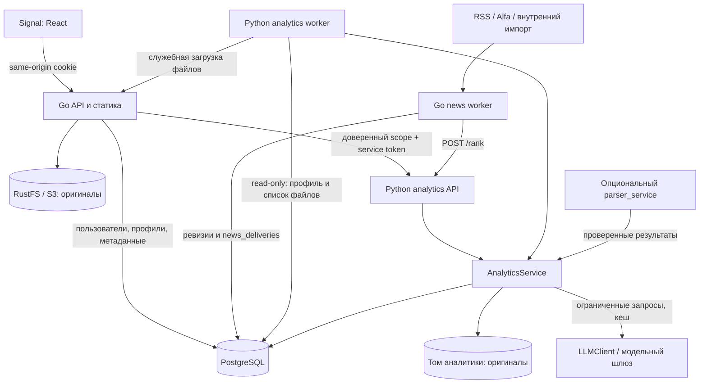

# Архитектура единого приложения

Состояние на 24 октября 2026: Signal, Go backend, аналитический API и фоновые
воркеры соединены. Основной путь проверяется через настоящие HTTP-сервисы и
временную PostgreSQL. Тесты используют синтетические ответы модели и источников.
[Отчёт интеграции и команды запуска](integration-main-2026-10-24.md).

## Компоненты

| Процесс | Ответственность | Точка входа |
|---|---|---|
| Go API | Пользователи, cookie-сессии, профиль, файлы, лента, proxy, SPA | `backend/cmd/server` |
| Go worker | Источники, ревизии, claim/retry доставок, `/rank`, обновление ленты | `backend/cmd/worker` |
| Python API | Закрытый `/rank` и `/v1/analytics`, результаты, state/chat/refresh | `orchestrator.analytics.app:create_app` |
| Python worker | Компании, файлы, импорт parser jobs, аналитические задания | `python -m orchestrator.analytics.worker` |

Go-сервер и сборщик находятся в одном образе с React; аналитика использует второй
образ. Модельные вызовы выполняются в Python. Старый `orchestrator.api` сохранён
для прежних сценариев; Compose/Helm запускают analytics host.

## Путь данных

1. **Регистрация.** Атомарный запрос создаёт компанию, пользователя с паролем и
   роли. `Idempotency-Key` допускает повтор после сетевого сбоя. Сервер выдаёт
   сессию; восстановление страницы использует `/auth/me`.
2. **Профиль и документы.** Go хранит профиль в `companies.profile`, метаданные в
   `company_files`, оригиналы в S3. Python читает метаданные короткими read-only
   транзакциями; содержимое получает через закрытый маршрут Go. Файл до 12 МиБ
   имеет состояния `queued/ready/failed` и ограниченные повторы. После успеха он
   повторно не скачивается.
3. **Знания.** `KnowledgeService` извлекает структуру, чанки, проверяемые факты и
   связи. Оригинал также сохраняется на томе аналитики. Значения формы профиля
   используют общий `profile_evidence` и помечаются `user_asserted`; это заявления
   пользователя, не подтверждённые документом факты.
4. **Новости.** Go сохраняет источник, время публикации, доступный полный текст и
   ревизию, атомарно создавая доставки. В `/rank` передаёт текущую компанию и
   объединённый набор её директорских ролей. Python создаёт глобальное событие
   один раз, затем оценивает применимость к знаниям конкретной компании.
5. **Влияние и ситуации.** Retrieval собирает evidence из точных совпадений, FTS,
   доступных векторов и графа. `CompanyImpact` содержит обоснование и маршрут.
   Принятые влияния собираются в версионные `BusinessIssue` и готовый
   `SituationSnapshot` по роли. Смешанный риск/возможность сохраняется в аналитике;
   совместимая лента получает `kind=event`. Её `score` — порядок срочности,
   не вероятность.
6. **Чтение и действия.** Signal читает готовые сводку, evidence и историю без LLM.
   `refresh` ставит задание; UI показывает статус. Вопрос к ситуации вызывает
   модель с evidence и фиксирует диалог на версии ситуации. State и диалоги
   изолированы по пользователю.

Python worker обходит компании пачками с сохраняемым курсором, подхватывает
изменение профиля/файлов и суточный refresh. Перезапуск продолжает работу по
сохранённым состояниям, кешу и leases.

## Хранение и согласованность

- **Go / public:** компании, пользователи, `auth_sessions`, роли, справочники,
  `company_files`, `news_items`, `news_deliveries`, `feed_items`.
- **analytics:** версионные документы, факты, события, impacts, issues, snapshots,
  evidence, состояния, диалоги, jobs, кеш и ограничения модели. Checkpoint-таблицы
  LangGraph создаются явной миграцией.
- **parser:** PostgreSQL очередь и сохранённые результаты сборщика. DSN задаётся
  явно; parser можно оставить выключенным.
- **Оригиналы:** S3 остаётся основным хранилищем загрузок; том аналитики содержит
  копии для knowledge pipeline. Backup включает обе копии и PostgreSQL.

`news_deliveries` остаётся единственной очередью Go для оценок: `SKIP LOCKED`,
lease, fencing token, ограниченный retry/backoff. Таблицы рейтинга из main
сохранены для совместимости миграций; второго кеша LLM в Go нет. Исправление
новости скрывает старую ленту до оценки новой ревизии. Python кеш привязан к
политике, ревизиям и контексту. Advisory locks сериализуют конкурирующие обновления;
ожидание ограничено таймаутом.

Go применяет встроенные additive миграции при старте. Python выполняет отдельную
команду `analytics migrate`; общий lock защищает также `PostgresSaver.setup()` от
одновременного старта API и worker. Major PostgreSQL в Helm/Compose остаётся 16;
образ заменён на pgvector с той же major-версией.

## Доступ

Браузер работает с одним origin. Пароли хешируются bcrypt, случайные сессии
хранятся в PostgreSQL в виде SHA-256 и выдаются в HttpOnly/SameSite cookie;
на HTTPS включён Secure. Вход ограничен по IP, изменяющие запросы проверяют Origin.
Go проверяет владельца и назначенную роль и сам выставляет Python scope: tenant
`alpha`, company ID, user ID, role. Scope/auth headers браузера не доверяются.
Proxy разрешает только перечисленные маршруты чтения и действий.

Python API закрыт service token; в Helm у него только ClusterIP. Отдельный
`INTERNAL_API_TOKEN` защищает импорт новостей и чтение оригиналов. Служебные HTTP
клиенты не следуют redirect. Чужой company/user ID и неназначенная роль не дают
доступа. Старым аккаунтам оператор назначает пароль; публичного присоединения к
компании по одному ИНН нет.

## Парсер и необязательные возможности

`parser_bridge` переиспользует `JobRepository`, `SourcePolicy`, `Worker` и схемы
`JobResult`. Этот отдельный сбор ЦБ требует явных разрешений fetch/persist.
Стандартная Go-лента получает ЦБ, Интерфакс и Frank Media через
[RSS-сборщик](news-sources.md). Через Python bridge в analytics допускаются
полный текст и точное подтверждённое время публикации; результаты с датой только
до дня сохраняются с причиной ожидания. Старый результат не отменяет новую
ревизию. Политика robots/источника не обходится.

По умолчанию retrieval лексический. Локальные semantic embeddings, Graphify и
System One triage включаются явно с подготовленными ресурсами. Триаж — подсказка,
он не заменяет assessment. Для обычного запуска эти возможности не обязательны;
детали — в [analytics README](../orchestrator/analytics/README.md).

Обоснования решений: [ADR единого контура](decisions/0001-unified-runtime.md).
