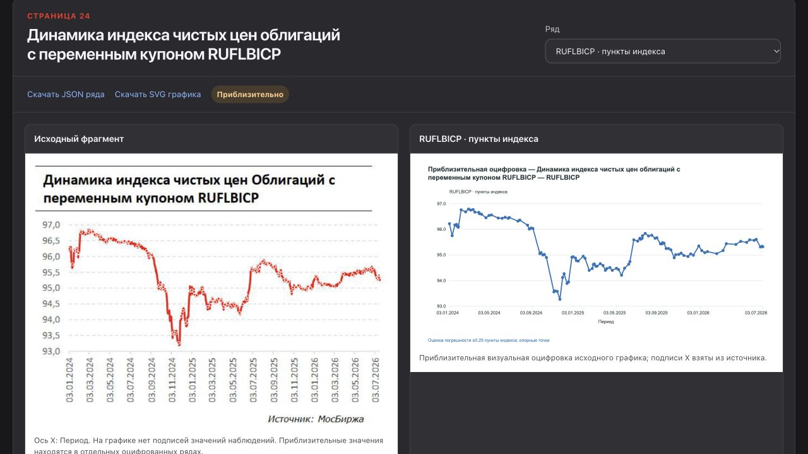

# Графики из отчётов Альфа-Банка

Набор содержит **97 диаграмм из девяти PDF**. Каждый отдельный ряд имеет свой
JSON; если в одной диаграмме пять линий, экспортируются пять файлов.
Всего **253 файла рядов**: 194 с оцифровкой, 40 только с точными подписями
и 19 с объяснением недоступности чисел. Для 234 доступных рядов есть SVG. Для рядов
с числами также создаётся отдельный SVG. Общая вырезка PDF сохраняется как
источник для проверки.

В исходной разметке сохранены **309 напечатанных значений в 49 рядах**. К ним
добавлена приблизительная оцифровка контуров, столбцов и диапазонов. Точные
подписи не перезаписываются приближениями: они остаются в `exact_points`.
Тонкие неразличимые сегменты получают отдельный JSON со статусом `unavailable`
и объяснением, без придуманных чисел.

Это статический набор для демо. Страница сравнения работает без API, базы данных
и LLM; основной маршрутизатор Signal не изменён. Набор не является актуальной
рыночной лентой и не заменяет исходные таблицы отчётов.

## Открыть сравнение

```bash
cd frontend
npm ci
npm run dev
```

Откройте `http://localhost:5173/report-charts.html`. Выберите отчёт, диаграмму и
один ряд. Слева показан оригинальный фрагмент PDF, справа — самостоятельный SVG.
Переключатель накладывает измеренные опорные точки на исходник. Рядом доступны
скачивание JSON/SVG, просмотр JSON и ограничения оцифровки. На узком экране
панели располагаются друг под другом. Прогнозы выделены оранжевым.



## Файлы и формат

| Путь | Содержимое |
|---|---|
| `frontend/public/report-charts/series-index.json` | Индекс всех отдельных рядов, статусы и пути |
| `frontend/public/report-charts/series/*.json` | Один ряд: точки, источник, шкала, координаты и ограничения |
| `frontend/public/report-charts/series/*.svg` | Самостоятельная визуализация одного доступного ряда |
| `frontend/public/report-charts/images/*.jpg` | 97 исходных вырезок, около 15 МБ |
| `frontend/public/report-charts/catalog.json` | Каталог диаграмм, источников и разметки |
| `frontend/public/report-charts/points.csv` | Только 309 точных подписей; приблизительные точки сюда не смешиваются |
| `eda/report_charts/*.json` | Проверяемая разметка и калибровки оцифровки |
| `scripts/prepare_report_charts.py` | Проверка PDF, экспорт и проверка сохранённых файлов |
| `scripts/report_chart_series.py` | Разделение рядов, преобразование координат и SVG |
| `frontend/src/components/ReportSeriesComparison.tsx` | Компонент сравнения и наложения опорных точек |

Статус **ряда** в индексе и отдельных JSON:

- `labelled_values`: только напечатанные значения; ряд может быть частичным.
- `digitized`: приблизительные значения по изображению; возможны сохранённые
  точные подписи в `exact_points`.
- `unavailable`: ряд учтён, но надёжно отделить его контур не удалось.

Пример имени: `series/fi-market-indices--rgbi.json`. Полная запись содержит
`schema_version`, идентификаторы, `label`, `unit`, `data_status`, `source`,
`x_axis`, `note`, `exact_points`, `digitization`, `points`, `json_file`, `svg_file`.
`source` включает имя и SHA-256 PDF, страницу, область вырезки и SHA-256 JPEG.

Для точных значений `points` содержит текстовые категории:

```json
{"x": "2026П", "value": 10.5, "source_index": 3, "forecast": true}
```

Для оцифровки X — **нормированная позиция от 0 до 1**, а Y — величина в единицах
ряда. Ниже иллюстрация структуры, не котировка из отчёта:

```json
{"x": 0.25, "value": 118, "forecast": false}
```

Подписи дат/категорий и их позиции находятся в `digitization.x_ticks`. Даты
между ними не выдумываются и не подменяются ближайшей подписью. Для построения
исходной формы используйте числовой x и метки из `x_ticks`. У диапазона вместо
`value` есть `value_low`/`value_high`. Полный контракт —
[разметка и калибровка](../eda/report_charts/README.md).

## Как получены значения и где ограничения

PDF состоят из растровых страниц. Используется существующий PyMuPDF для
воспроизводимого рендеринга; новые runtime-зависимости не добавлены. Подписанные
значения перенесены из изображений, контуры оцифрованы через опорные точки с
визуальным наложением на оригинал. Это разметка конкретных девяти отчётов,
а не автоматический распознаватель любого будущего PDF.

Калибровка привязана к SHA-256 конкретного JPEG. У каждого ряда своя шкала Y,
поэтому правая и левая оси не смешиваются. Отрицательные сегменты составных
столбцов сохраняют знак; отдельный SVG показывает их величину от нуля, а
наложение — первоначальное положение в стеке. Линии соединяют опорные точки
линейно; scatter-точки не соединяются.

`estimated_error` — визуальная оценка погрешности Y, **не гарантированная граница
и не статистический доверительный интервал**. Погрешность X отдельно не оценена.
Число десятичных знаков выбирается по `estimated_error`, чтобы округление
не стало главным источником ошибки. Эти знаки не означают точность измерения.
Наложения линий, размытые тонкие сегменты и обрезанные пики ограничивают полноту.
Пропуски не заменяются нулями, обрезанные пики не экстраполируются. Ограничения
каждого ряда записаны в его профиле. Для точных расчётов нужны исходные таблицы.

Прогнозные точки сохраняют `forecast`; у оцифровки порог хранится в
`digitization.series[0].forecast_from`. Округлённые доли не нормализуются:
например, подписанные доли первичного рынка в PDF суммируются в 101%.

## Переиспользовать в виджетах

Статические файлы обслуживаются по `/report-charts/`. `parseReportChartCatalog`
проверяет каталог, `parseReportSeriesIndex` связывает строки индекса с рядами и
источниками, `parseReportSeries` проверяет загруженный файл. Изолированная
страница показывает последовательность загрузки и обработку ошибок.

`ReportSeriesComparison` принимает `chart` и относящиеся к нему `items` из
проверенного индекса. Существующий `ReportChart` остаётся доступен для просмотра
только напечатанных значений. Основной `TrendChart` и рабочие API не подключены.

## Воспроизвести и проверить

```bash
python scripts/prepare_report_charts.py --input /path/to/reports
python scripts/prepare_report_charts.py --check
python -m unittest scripts.test_report_charts scripts.test_report_chart_series -v
cd frontend
npm run test -- --run
npm run build
npm run test:e2e
```

Исходная папка должна содержать все девять PDF с именами и SHA-256 из разметки.
До публикации экспорта проверяются все документы; рендеринг и генерация идут
во временную папку. Каталог публикуется последним. `series/` принадлежит
генератору: устаревшие JSON/SVG удаляются при успешном обновлении.

`--check` не требует исходных PDF. Он сверяет разметку с каталогом, декодирует
все JPEG, проверяет их размеры/хеши и побайтово сравнивает CSV, индекс и все
отдельные JSON/SVG. Рендеринг может отличаться между версиями PyMuPDF; при
смене JPEG нельзя просто заменить хеш в калибровке без повторной проверки.

Python-тесты проверяют источник, сохранность подписей, отдельные файлы,
отрицательные стеки, независимые шкалы, прогнозы и координаты SVG. Фронтенд
проверяет формат, происхождение данных, ошибки загрузки, переключение рядов,
наложение и адаптивность. Проверка экспорта включена в `pipeline-tests.yml`.
Эти тесты подтверждают код и целостность набора, а не истинность каждого
приблизительного наблюдения; для данных проводится отдельная визуальная проверка.

## Проверка версии от 25 октября 2026

- 14 Python-тестов и побайтовая проверка всего экспорта — успешно.
- 173 unit-теста фронтенда, TypeScript и Vite build — успешно.
- 58 браузерных сценариев на изолированных серверах — успешно.
- Все 253 файла проходят runtime-парсер; 49 исходных рядов и 309 точных
  подписей совпадают с первой версией без изменений.
- 194 приблизительных ряда содержат 7 050 опорных точек/диапазонов.
  Проверка контуров проводилась наложением на исходные JPEG; неразличимые
  участки и ограничение точности описаны в профилях.
